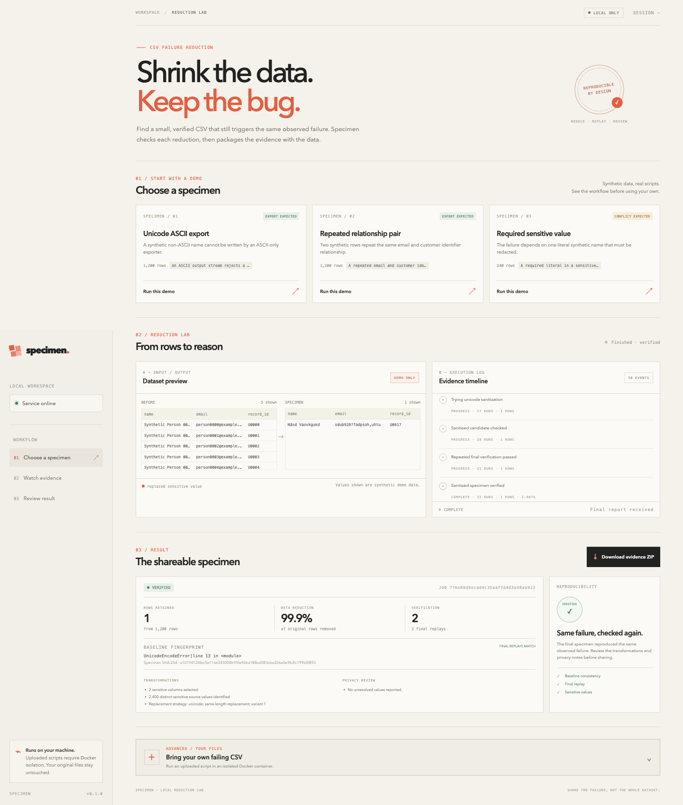

# Specimen

**Shrink the data. Keep the bug.** Specimen reduces a failing CSV to a smaller shareable specimen and checks that the same observed Python failure still occurs. Its main output is a reproducible input plus execution evidence, not an AI explanation.

Specimen is an early local tool for deterministic CSV/Python failures. It does not prove that two executions have the same root cause, guarantee a globally smallest CSV, or guarantee complete anonymization. Pseudonymization preserves structure and can leave identifying context in data that was not selected for replacement. Review every artifact before sharing it.



## Quickstart

Requires Python 3.11 or newer and [uv](https://docs.astral.sh/uv/). Python 3.12 is the recommended runtime. From the repository root:

```sh
uv sync --extra dev
uv run specimen demo unicode
```

The demo runs a checked-in synthetic fixture on the local host. The CLI prints progress to stderr and a JSON report to stdout. A successful run writes `specimen.csv`, `repro.py`, `report.json`, and `REPORT.md` under `specimen-output/`.

To open the local dashboard:

```sh
uv run specimen serve
```

Then open [http://127.0.0.1:8765](http://127.0.0.1:8765). The dashboard uses bundled synthetic demos without Docker. Uploads are disabled until Docker is available with the `python:3.12-slim` image; see [Using your own files](#reduce-your-own-files).

## Try the bundled cases

All bundled rows are synthetic. The expected outcomes describe the checked-in scenarios, not a promise about arbitrary inputs.

| Demo | Input | Expected outcome |
| --- | ---: | --- |
| `unicode` | 1,200 rows | A one-row specimen retains the ASCII-export failure after Unicode pseudonymization. |
| `relations` | 1,200 rows | A two-row specimen preserves a repeated email/customer-ID pair and its failure. |
| `conflict` | 240 rows | The failure depends on a sensitive literal, so Specimen blocks a shareable verified specimen. |

Run another case or choose an output directory:

```sh
uv run specimen demo relations --output ./relation-output
uv run specimen demo conflict --output ./conflict-output
```

The dashboard presents the same fixtures and shows their actual run events. Demos use trusted, checked-in scripts in local mode; they are intended for learning the workflow, not as a sandbox for arbitrary code.

## Reduce your own files

The CLI defaults to Docker execution for supplied scripts. Pull the runner image before using it:

```sh
docker pull python:3.12-slim
uv run specimen reduce ./input.csv --script ./repro.py --sensitive email customer_id --output ./specimen-output
```

The reproducer receives its CSV path as `sys.argv[1]`. Supply sensitive column names after `--sensitive`; comma-separated names are also accepted. Header-based detection also selects common sensitive names such as `email`, `phone`, `address`, `name`, and `customer_id`. Explicit selections and automatic detection are combined.

Docker mode runs the script with no network, a read-only container filesystem, read-only input mounts, dropped Linux capabilities, and resource limits. A Docker run is still execution of user-supplied code and depends on the host Docker daemon and kernel. Keep Docker and the host patched, and review scripts and inputs before running them.

To opt into host execution instead:

```sh
uv run specimen reduce ./input.csv --script ./repro.py --sensitive email customer_id --runner local
```

**Local mode is explicitly trusted execution:** the script runs directly as the current user, without a sandbox. Do not use it for untrusted scripts.

The CLI command forms are:

```text
specimen demo [-h] [--output OUTPUT] [--runner {local,docker}] [--model-assist]
              [{unicode,relations,conflict}]
specimen reduce [-h] --script SCRIPT [--sensitive [COLUMN[,COLUMN] ...]]
                [--output OUTPUT] [--runner {docker,local}] [--model-assist] input_csv
specimen serve [-h] [--port PORT]
```

Use `uv run specimen --help` and `uv run specimen demo --help` for the installed CLI's full help.

## Read the result

Pseudonym mappings use a fresh random key per run, so replacement bytes and artifact hashes can change across runs even when the retained row count and failure signature are stable.

The engine runs the baseline more than once, records a compact fingerprint for the observed exception, removes rows while replaying the script, pseudonymizes selected values consistently, and repeats the final check. It uses bounded deterministic row deletion; when exhaustive row-deletion passes complete, the result is **1-minimal by row deletion**: removing any one remaining row no longer preserves the fingerprint under the tested script and configuration. This is not a globally smallest CSV and does not establish the underlying cause.

The fingerprint identifies the exception type and the reproducer's final script frame (line and function). It intentionally omits exception messages and raw stdout/stderr. This is evidence that the same observed signature survived, not proof that the same root cause occurred. A script can raise the same exception at the same line for different reasons.

Reports can end in `verified`, `unstable`, `not_reproduced`, `budget_exhausted`, `needs_review`, or `error`. Only `verified` plus a successful privacy scan enables a shareable ZIP. A blocked or unverified run does not produce a shareable dataset/script pair. Inspect `blockers`, `verification`, `transformations`, and `artifact_names` in `report.json` and `REPORT.md`.

The ZIP contains only the reviewed artifact allowlist: `specimen.csv`, `repro.py`, `report.json`, `REPORT.md`, and `REPRODUCE.txt`. `repro.py` is the tested reproducer, so review it before sharing. The archive is withheld when its privacy checks find an unresolved source value or suspicious secret/email text. These checks are guardrails, not a complete data-loss-prevention system.

## Optional model adviser

The deterministic workflow works without a model. `--model-assist` opts into an OpenAI-compatible policy adviser configured through these environment variables:

```text
SPECIMEN_MODEL_BASE_URL
SPECIMEN_MODEL_NAME
SPECIMEN_MODEL_API_KEY
```

See [.env.example](.env.example) for names only; it is not loaded automatically. Set the variables in your shell or environment. The adviser is requested once before reduction and can suggest sensitive column positions and a bounded strategy. It receives column positions and coarse aggregate metadata (such as length and uniqueness buckets), not cell values or header names. Advice is parsed and validated; it does not decide whether the failure is verified. No model calls occur inside the deletion search. Do not enable it unless you are comfortable sending those coarse data properties to your configured endpoint. HTTP endpoints are accepted only for loopback hosts; remote endpoints must use HTTPS.

See the [build and verification log](docs/BUILD_LOG.md) for the Alan development workflow and actual test results. This repository does not claim a verified Alan API connection, and Specimen does not require one.

## Development

```sh
uv sync --extra dev
uv run pytest
node --check specimen/web/app.js
```

The tests use synthetic examples and local runner fixtures; no Docker daemon or model credentials are required for the unit suite. See [Architecture](docs/ARCHITECTURE.md) for system boundaries and [Demo storyboard](docs/DEMO.md) for a short walkthrough.

## Limitations and review

- CSV and Python reproducer only; intended for deterministic script failures.
- The reducer has execution and time budgets. Exhaustion is reported rather than silently presented as a complete reduction.
- Sensitive-field replacement is pseudonymization, not anonymization. Same-length, same-character-class replacements can preserve format and relationships; context, rare combinations, and values outside selected fields may still identify people.
- Human review is required before publishing a specimen, reproducer, report, or archive.
- Uploaded scripts are Docker-backed only in the dashboard. Docker isolation reduces exposure but is not a guarantee against all host or container vulnerabilities.
- Local CLI mode is not sandboxed.

## License

MIT. See [LICENSE](LICENSE).
